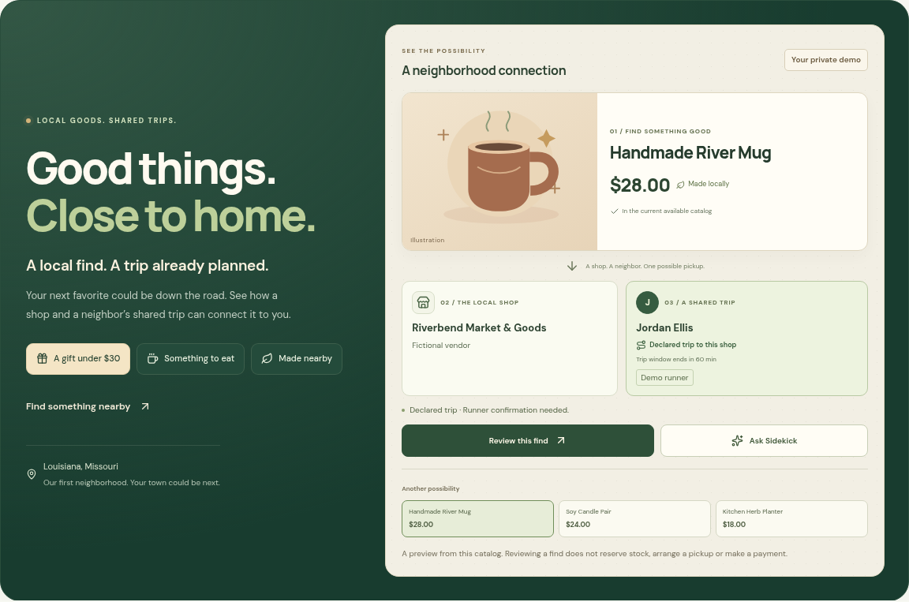

# Neighborhood Connection

This release turns the first screen into an interactive preview of the product's core idea: a current catalog item, its shop and a neighbor's declared trip. It replaces the previous introduction with one responsive connection canvas, while retaining the existing catalog, assistant, reviewed order preparation and role workflow.

Visitors choose **A gift under $30**, **Something to eat** or **Made nearby**, then compare up to three available finds. The item, price and shop come from the caller's visible catalog. The illustration is labeled separately from a product photograph. **Review this find** opens that actual listing; **Ask Sidekick** uses its explicit ID so duplicated product names cannot select a different listing.

A runner appears only when the visible trip targets that exact shop and both the runner's availability and trip window are unexpired. The panel labels this as a declared-trip candidate requiring confirmation. Its countdown is the end of that window, not a delivery estimate. The browser withdraws expired candidates without polling; newly posted trips and stock changes require a fresh catalog read or the existing server-side checks. The preview is deterministic and does not claim an AI booking, route optimization, guaranteed delivery or saved emissions.

When no trip is available, the panel says so. If Demo Mode is enabled, **Build a private demo** explicitly creates a fresh fictional customer/vendor/runner workspace through the existing demo entry endpoint. It does not prepare an order or invoke a payment. Public demo availability is never manufactured to fill an empty panel. Existing fictional-vendor, demo-runner, private-workspace and simulated-payment labels remain visible.

The entry banner is more compact so the product preview appears sooner on phones. Role responsibilities remain available after entering Demo Mode. The existing map fallback still preserves browsing when WebGL is unavailable, and the connection canvas itself uses ordinary HTML/SVG.

The server adds the chosen trip's existing expiry timestamp to the public runner DTO. Destination and expiry come from the same scoped trip row. Existing RLS, workspace filtering, narrow server-only scope lookup, order preparation, acceptance and payment permissions are unchanged. No migration, dependency or new environment variable is required.

Release verification is recorded on source `080381b1643b4ee0ba65da501d579b80c18c47bc`, whose application code is identical to the initial UI commit `fffbf2c`; the follow-up scopes two older browser checks to their intended directory and storefront. The [clean-machine CI run](https://github.com/bryan060807/local-town-runners/actions/runs/40629054371) passed **116 unit/database tests and 128 browser checks**: 40 offline and 88 connected, across desktop and 360/390/430px layouts. Dependency audit reported zero vulnerabilities.

The [live browser verification](evidence/neighborhood-connection-live-qa.json) passed four public profiles, including WebGL disabled, and a fresh private Customer demo. It checked all three intents, actual listing review, exact-item Sidekick context, no horizontal overflow and successful demo exit. This preview check created **zero orders, runner assignments or provider financial calls**. All **ten read-only production checks** passed; the three preserved genuine Sandbox orders remain PAID, with $44.00 and their complete order/ledger fingerprint unchanged. Historical capture and signed-webhook proof remains separate from this UI check.

See the [verification report](evidence/neighborhood-connection.json), [CI evidence](evidence/neighborhood-connection-ci.json), [production evidence](evidence/neighborhood-connection-production.json) and [screenshot provenance](screenshots/neighborhood-connection/README.md). The evidence records the corrected initial test-selector failures and the diagnostic helper's rejected cleanup request, including guarded expiration of only its own newly created demo ticket. These corrections did not change application behavior or protected payment records.

The [judge walkthrough](hackathon-demo.md) and [full demo guide](demo-order-walkthrough.md) use the private $28 Handmade River Mug connection. The separately labeled existing $4.50 genuine PayPal Sandbox proof remains distinct from that simulated order and from any preview.
